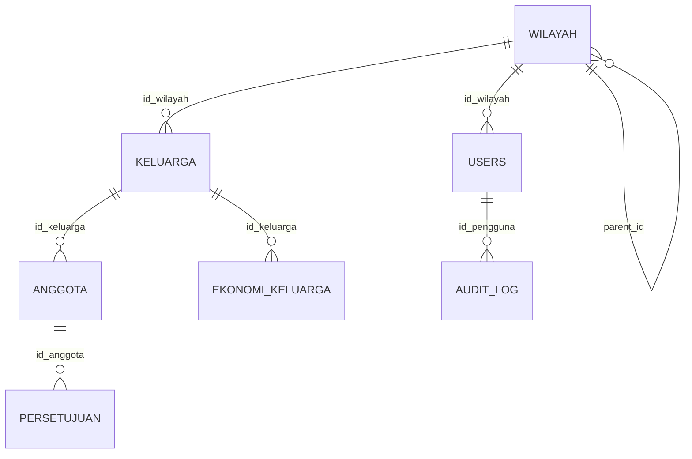

# CODEBASE — Rukun Data

Dokumentasi hasil penelusuran kode pada 31 Oktober 2026. Menjelaskan implementasi yang tersedia, bukan rencana dalam komentar PRD/DESIGN. Pemindaian awal dilakukan secara statis. Implementasi lanjutan dan hasil pengujiannya dijelaskan pada bagian 12; dependensi kini telah dipasang menggunakan PHP 8.2. Nilai `.env` lokal tidak digunakan dalam dokumentasi ini.

## 1. Gambaran aplikasi

Rukun Data adalah aplikasi administrasi penduduk berbasis wilayah. Petugas mengelola keluarga (KK), anggota keluarga, dan data ekonomi melalui panel web. Akses data mengikuti penugasan RT/RW, sedangkan administrator dapat bekerja lintas wilayah.

Aplikasi berbentuk monolit Laravel dengan antarmuka Filament/Livewire. Logika interaksi banyak berada langsung di Resource dan Page Filament; tidak ada lapisan REST API atau controller bisnis tersendiri yang didaftarkan dalam routing saat ini. Halaman `/` langsung mengarah ke `/admin`; template `welcome.blade.php` masih ada tetapi tidak digunakan oleh route tersebut.

## 2. Stack dan struktur

Versi berikut merupakan rentang dependensi dalam manifest; versi instalasi dikunci dalam lockfile.

| Komponen | Teknologi |
|---|---|
| Runtime | PHP `^8.2` |
| Backend | Laravel `^12.0`, Eloquent |
| Panel | Filament `^5.10`, interaksi Livewire |
| Frontend | Blade, Tailwind CSS `^4.0.0`, Vite `^7.0.7` |
| Database contoh konfigurasi | MySQL; pengujian menggunakan SQLite in-memory |
| Testing | PHPUnit `^11.5.50`, test komponen Livewire |
| Tooling | Composer, npm, Pint, Pail, concurrently |

| Lokasi | Tanggung jawab |
|---|---|
| `bootstrap/app.php`, `bootstrap/providers.php` | Bootstrap Laravel, routing, health check, registrasi provider |
| `routes/web.php` | Redirect root ke panel |
| `app/Providers/Filament/AdminPanelProvider.php` | Login, middleware, discovery halaman/resource/widget, tema panel |
| `app/Filament/Resources/` | Form, tabel, aksi, serta halaman CRUD |
| `app/Filament/Pages/JelajahWilayah.php` | Navigasi wilayah dan pencarian KK/NIK |
| `app/Filament/Widgets/` | Statistik dashboard |
| `app/Models/` | Relasi Eloquent, enkripsi melalui mutator, scope dan hook model |
| `app/Enums/Role.php`, `app/Policies/` | Peran dan izin tindakan |
| `app/Support/`, `app/Scopes/` | Enkripsi/HMAC dan pembatasan data wilayah |
| `app/Observers/`, `app/Rules/` | Audit dan validasi hierarki wilayah |
| `database/migrations/`, `database/seeders/` | Skema, master referensi, data contoh |
| `resources/views/filament/` | View jelajah dan manajemen hierarki |
| `resources/css/filament/admin/theme.css` | Tema panel khusus |
| `tests/Feature/` | Pengujian alur bisnis, akses, enkripsi, dan halaman |

## 3. Flow utama

```mermaid
flowchart TD
    A[Pengguna membuka /] --> B[/admin]
    B --> C[Login username dan password]
    C --> D{Akun aktif dan kredensial valid?}
    D -- Tidak --> C
    D -- Ya --> E[Dashboard sesuai lingkup pengguna]
    E --> F[Jelajah Wilayah]
    F --> G[Pilih wilayah sampai RT]
    G --> H[Daftar keluarga dalam RT]
    H --> I[Detail keluarga dan anggota]
    G --> J[Tambah keluarga]
    J --> K[Form keluarga, ekonomi, anggota]
    K --> L[Validasi dan penyimpanan relasi]
    L --> M[Mutator enkripsi dan HMAC]
    M --> N[Database dan audit observer]
    F --> O[Cari No KK atau NIK persis]
    O --> I
```

### Login dan sesi

`app/Filament/Pages/Auth/Login.php` mengganti field email Filament dengan username. Kredensial mencakup `is_active = true`. `User::canAccessPanel()` juga memeriksa status aktif. Tidak ada registrasi mandiri yang diaktifkan pada panel.

Panel menggunakan cookie, session, CSRF, route binding, serta middleware autentikasi Filament. `.env.example` menggunakan session berbasis database. Akun baru dibuat melalui manajemen pengguna; email internal dibentuk dari username saat create.

### Jelajah wilayah

Implementasi utama: `app/Filament/Pages/JelajahWilayah.php` dan `resources/views/filament/pages/jelajah-wilayah.blade.php`.

1. Superadmin/admin mulai dari negara pertama yang ditemukan; admin RW mulai dari RW penugasannya; admin RT langsung dari RT penugasannya.
2. Pengguna memilih anak wilayah secara bertahap. Pencarian opsi menyaring nama/kode pada langkah aktif.
3. Mundur ke level sebelumnya membuang pilihan di bawahnya.
4. Daftar keluarga baru menggunakan RT terpilih; sebelum RT tersedia query memakai ID yang tidak cocok.
5. Tabel menampilkan No KK tersamar, jumlah anggota aktif, dan kode pos; pagination 25, 50, atau 100 baris.
6. Tautan `/admin/jelajah/{wilayah}` mengisi rantai pilihan. Node di luar subtree pengguna ditolak dengan 404.
7. Tombol tambah meneruskan `id_wilayah` ke form keluarga. Superadmin/admin juga dapat membuka tambah sebelum memilih RT.

Hierarki: `negara → provinsi → kabupaten_kota → kecamatan → desa → [dusun] → rw → rt`. RW boleh langsung di bawah desa atau melalui dusun.

### Tambah dan ubah keluarga

Sumber: `KeluargaResource.php`, `Pages/CreateKeluarga.php`, `Pages/EditKeluarga.php`.

- Pilih RT: administrator memakai pilihan wilayah bertingkat; admin RW memilih RT di bawah RW; admin RT menggunakan wilayah penugasannya.
- Isi No KK 16 digit, alamat, dan kode pos 5 digit.
- Data ekonomi opsional melalui repeater yang saat ini dibatasi satu item pada form: tahun dan kategori Miskin/Rentan Miskin/Menengah/Mampu.
- Tambahkan minimal satu anggota: NIK, nama, kelahiran, jenis kelamin, status kawin, referensi agama/pendidikan/pekerjaan/hubungan, serta data orang tua dan penghasilan opsional.
- Hook create memeriksa duplikat KK/NIK yang terlihat dalam scope, termasuk arsip, lalu memastikan tepat satu kepala keluarga. Hook edit keluarga juga menghitung tepat satu kepala dari state repeater.
- Repeater `relationship()` menyimpan anggota dan ekonomi melalui relasi Eloquent. Mutator model menghasilkan ciphertext dan indeks HMAC; observer mencatat audit.

Komentar menyatakan penyimpanan keluarga dan relasi berlangsung dalam satu transaksi. Panel kini mengaktifkan `databaseTransactions()`. Test integrasi juga menggagalkan anggota kedua melalui form dan memastikan keluarga/anggota di-rollback.

### Detail, edit anggota, arsip, dan pencarian

Detail keluarga menampilkan identitas keluarga, anggota, dan ekonomi. Detail/edit anggota memiliki halaman tersendiri; penambahan anggota dilakukan lewat keluarga. `EditAnggota` memeriksa perubahan hubungan agar tidak menciptakan kepala kedua atau menghilangkan kepala yang tersisa.

Keluarga dan anggota memakai `SoftDeletes`. Resource menyediakan aksi hapus/pulihkan dan filter Sampah, tetapi daftar datar keluarga disembunyikan dari sidebar, sedangkan anggota tidak memiliki route index. Pemulihan anggota melalui UI perlu ditinjau karena tabel resource memiliki aksi restore tetapi tidak mempunyai halaman daftar. Tidak ditemukan cascade soft-delete keluarga ke anggota; cascade foreign key berlaku untuk penghapusan fisik.

Pencarian utama pada Jelajah menerima nomor lengkap 16 digit, mencari KK terlebih dahulu lalu NIK melalui HMAC. Query tetap terkena scope wilayah dan tidak mencakup arsip. Jika ditemukan, pengguna diarahkan ke detail; jika tidak, muncul notifikasi. `AnggotaResource` juga memiliki implementasi pencarian nama berdasarkan token kata HMAC, tetapi tabel itu tidak mempunyai route index aktif.

### Manajemen wilayah dan akun

Wilayah memiliki mode hierarki, breadcrumb, pilihan anak, serta mode daftar semua. Form memvalidasi level induk melalui `IndukWilayah`; `WilayahObserver` menegakkan aturan yang sama pada model. `path` otomatis dibentuk setelah record dibuat. Mengubah level atau memindahkan induk ditolak. Penghapusan memeriksa keberadaan anak/keluarga dan dibatasi foreign key.

Manajemen pengguna memvalidasi role dan kecocokan level wilayah pada create/edit. Admin RW wajib menunjuk RW dan admin RT wajib menunjuk RT. Akun tidak dihapus; status aktif digunakan untuk menonaktifkan. Peran/status diri sendiri dipertahankan oleh hook edit. Superadmin tidak dapat dinonaktifkan melalui izin `deactivate`; admin juga tidak dapat menonaktifkan sesama admin.

## 4. Peran dan isolasi data

| Peran | Lingkup KK/anggota | Kelola KK/anggota | Kelola wilayah | Buat akun |
|---|---|---|---|---|
| `superadmin` | Semua | Ya | Semua level | Semua peran |
| `admin` | Semua | Ya | Semua level | Admin RW dan Admin RT |
| `admin_rw` | RT dalam subtree penugasan | Ya | RT di bawah RW-nya | Tidak |
| `admin_rt` | RT penugasan | Ya | Tidak | Tidak |

Tabel mengikuti kode policy/resource aktif. Beberapa komentar masih menyebut tiga peran atau admin RW hanya membaca; implementasi saat ini memiliki empat peran dan mengizinkan admin RW mengubah data.

`WilayahAccess::allowedRtIds()` menghasilkan `null` untuk akses tanpa batas, array ID untuk lingkup terbatas, atau array kosong jika tidak memiliki wilayah valid. `WilayahScope` dipasang pada `Keluarga` dan `Anggota`; anggota disaring melalui relasi keluarga. Policy menjadi pemeriksaan izin tindakan tambahan. Resource wilayah memiliki filter query tersendiri.

Tanpa pengguna login, helper wilayah mengembalikan akses tanpa batas untuk konteks console/seeder/queue. Model ekonomi dan persetujuan tidak memiliki scope wilayah sendiri. Helper `findByNoKk()` dan `findByNik()` sengaja melepas semua global scope dan mencakup arsip: pemanggil baru harus menerapkan otorisasi yang sesuai. Pencarian Jelajah tidak menggunakan helper tanpa scope tersebut.

## 5. Model data



| Tabel/model | Isi dan aturan penting |
|---|---|
| `wilayah` | Kode, nama, level, tipe desa/kelurahan, parent, path; unique `(parent_id, kode)` |
| `users` | Username unik, password hash, role, wilayah, status aktif, pembuat; email bawaan Laravel tetap ada |
| `keluarga` | RT, No KK terenkripsi, HMAC KK unik, alamat terenkripsi, kode pos, pembuat, soft delete |
| `anggota` | Keluarga, identitas, demografi, FK referensi, HMAC NIK unik, token nama, kepala_lock, soft delete |
| `ekonomi_keluarga` | Kategori terenkripsi dan tahun; unique `(id_keluarga, tahun_data)` |
| `ref_agama`, `ref_pendidikan`, `ref_pekerjaan`, `ref_hubungan` | Master referensi; ID hubungan kepala ditetapkan `1` |
| `persetujuan` | Anggota, nama pemberi, tanggal, status aktif/dicabut; model/skema tersedia, UI belum ditemukan |
| `audit_log` | Pengguna, aksi, nama tabel, ID record, waktu |
| Tabel infrastruktur | Session, reset password, cache, jobs dan failed jobs sesuai migrasi Laravel |

`path` berbentuk `/1/12/45/` dan memungkinkan pencarian subtree dengan prefix `LIKE`. `kepala_lock` diisi ID keluarga untuk kepala, `null` untuk anggota lain. Unique constraint menjamin **maksimal satu** kepala, sedangkan syarat **minimal satu** dijaga form. Constraint database tidak menjamin keluarga selalu mempunyai kepala pada semua jalur penulisan/penghapusan.

## 6. Data sensitif dan audit

`app/Support/SensitiveData.php` menggunakan Laravel Crypt dengan `APP_KEY`. HMAC SHA-256 menggunakan `FIELD_HMAC_KEY` terpisah, minimal 32 karakter. Nomor dinormalisasi menjadi digit sebelum di-hash; nama dipecah menjadi kata lowercase lalu setiap kata di-hash.

Kolom terenkripsi: No KK, alamat, NIK, nama lengkap, nama ayah/ibu, penghasilan bulanan, dan kategori ekonomi. Tanggal/tempat lahir, jenis kelamin, status kawin, serta FK referensi tetap plaintext. Akses atribut model mendekripsi otomatis; `$hidden` mengecualikan sebagian atribut sensitif dari serialisasi, bukan pengganti otorisasi.

Daftar menampilkan nomor tersamar dengan enam digit terakhir. Detail memeriksa `bolehLihatDataPenuh()`: superadmin/admin/admin RT mendapat nomor penuh; admin RW mengikuti `RW_LIHAT_PENUH` (default false). Pembatasan ini bukan penyamaran seluruh data pribadi: detail masih menampilkan nama/alamat, dan form edit menggunakan atribut asli. Perilaku form edit untuk admin RW perlu ditinjau jika kebijakan yang diinginkan melarang akses nomor penuh.

`AppServiceProvider` memasang `AuditObserver` pada keluarga, anggota, ekonomi, wilayah, dan pengguna. Event create/update/delete/restore mencatat metadata tanpa salinan nilai kolom. Persetujuan tidak terdaftar pada observer tersebut. Penulisan query builder langsung atau `saveQuietly()` tidak memperoleh audit model biasa.

Mengganti APP_KEY memengaruhi dekripsi data lama; mengganti FIELD_HMAC_KEY memerlukan strategi pembentukan ulang indeks agar pencarian/keunikan tetap konsisten. Mekanisme rotasi khusus belum ditemukan.

## 7. Dashboard dan tampilan

Dashboard berisi ringkasan keluarga, anggota, kepala keluarga perempuan, usia produktif 18–59, serta grafik umur, keluarga per RT, jenis kelamin, pendidikan, dan pekerjaan. Widget berbasis model keluarga/anggota memperoleh scope wilayah secara otomatis dan menghitung dari kolom demografi/referensi.

Panel memakai Plus Jakarta Sans, sidebar 15rem, warna navy/teal, tema terang, dan tanpa topbar. Vite membangun CSS aplikasi, JS aplikasi, serta tema Filament. Blade/Livewire menangani navigasi jelajah; tidak ada aplikasi SPA terpisah.

## 8. Route utama

| Path | Fungsi |
|---|---|
| `/` | Redirect ke `/admin` |
| `/up` | Health check Laravel |
| `/admin/login` | Login panel |
| `/admin` | Dashboard |
| `/admin/jelajah/{wilayah?}` | Penjelajahan wilayah |
| `/admin/keluarga` | Daftar keluarga, tidak tampil di sidebar |
| `/admin/keluarga/create` | Tambah keluarga |
| `/admin/keluarga/{record}` dan `/{record}/edit` | Detail/edit keluarga |
| `/admin/anggota/{record}` dan `/{record}/edit` | Detail/edit anggota; tidak ada index |
| `/admin/wilayah`, `/create`, `/{record}/edit` | Resource wilayah |
| `/admin/pengguna`, `/create`, `/{record}/edit` | Resource pengguna |

Path panel diturunkan dari konfigurasi resource/page. Gunakan `php artisan route:list` setelah dependensi terpasang untuk daftar route runtime lengkap, termasuk endpoint internal Filament/Livewire.

## 9. Menjalankan lokal

Siapkan PHP yang memenuhi dependensi lockfile, Composer, Node/npm yang kompatibel dengan Vite, dan database MySQL. Untuk checkout baru:

```sh
composer install
cp .env.example .env
php artisan key:generate
```

Langkah menyalin `.env` hanya untuk checkout yang belum mempunyai konfigurasi; jangan menimpa `.env` yang sudah ada. Isi koneksi database dan `FIELD_HMAC_KEY` acak minimal 32 karakter sebelum migrasi/seeding. `RW_LIHAT_PENUH` dapat ditambahkan bila dibutuhkan. Konfigurasi contoh memakai database untuk session, queue, dan cache; mail diarahkan ke log.

```sh
php artisan migrate
php artisan db:seed
npm ci
npm run build
composer run dev
```

`composer run dev` menjalankan server Laravel, queue listener, Pail, dan Vite bersama-sama. `composer setup` tersedia sebagai shortcut install/key generation/migrate/build, tetapi tidak mengisi FIELD_HMAC_KEY atau menjalankan seeder. Jalankan key generation hanya pada instalasi baru.

`DatabaseSeeder` mengisi referensi, pohon wilayah contoh, akun demo, lima keluarga, dan anggota/ekonomi fiktif. Akun contoh antara lain `superadmin`, `admin`, `adminrw01`, dan `adminrt0101`, dengan password demo `password`; gunakan hanya untuk lingkungan pengembangan. Seeder memakai `create()` sehingga jangan diasumsikan aman dijalankan berulang pada database berisi data. Kode wilayah contoh bukan kode resmi Kemendagri.

`VolumeDummySeeder` tersedia untuk data volume pengembangan. Tidak ada job bisnis atau integrasi eksternal khusus yang ditemukan; konfigurasi mail/AWS/Redis bawaan tidak berarti layanan tersebut sudah dipakai oleh flow aplikasi.

## 10. Pengujian dan batas verifikasi

```sh
composer test
php artisan test --filter=AlurKeluargaTest
php artisan test --filter=WilayahIsolationTest
npm run build
```

`phpunit.xml` mengarahkan test ke SQLite in-memory, session/cache array, serta queue sync. Fixture bersama berada di `tests/Feature/FixturesRukunData.php`.

| Kelompok test | Fokus |
|---|---|
| `UsernameLoginTest`, `PanelSmokeTest`, `ExampleTest` | Login, route, halaman panel dan redirect |
| `AlurKeluargaTest`, `DuplicateAndRestoreTest`, `KepalaRuleTest` | Form keluarga, duplikat, arsip, transaksi eksplisit, kepala |
| `RoleAksesTest`, `RoleHierarchyTest`, `WilayahIsolationTest` | Peran, akun, batas wilayah, masking |
| `WilayahTest`, `JelajahWilayahTest`, `JelajahVolumeTest` | Hierarki, navigasi, pencarian, karakteristik query |
| `EncryptionAtRestTest` | Ciphertext pada database dan metadata audit |

Pada implementasi lanjutan, dependensi dipasang dan suite dijalankan; lihat bagian 12 untuk hasil aktual. Migrasi/seeding pengujian dijalankan pada database dummy terpisah.

## 11. Catatan pengembangan berikutnya

- Selaraskan komentar peran/izin dengan implementasi empat peran saat ini. Referensi `PRD` dan `DESIGN.md` ada pada komentar, tetapi dokumen tersebut tidak ditemukan dalam checkout.
- Pertahankan test rollback integrasi pada form keluarga yang kini tersedia.
- Lengkapi pengujian perubahan/hapus kepala keluarga, kepala yang terarsip, serta restore anggota. Unique `kepala_lock` masih mencakup baris soft-deleted.
- Periksa validasi duplikat lintas wilayah: pemeriksaan form mengikuti scope, sementara constraint hash bersifat global, sehingga pelanggaran dapat muncul sebagai error database.
- Tinjau jalur restore yang tersedia bagi pengguna dan aturan soft-delete keluarga beserta relasinya.
- `OperationalGuard` memvalidasi wilayah tujuan pada penulisan model; konteks create disimpan dengan atribut Livewire Locked. Pertahankan pemeriksaan ini saat menambah jalur input baru.
- `WilayahPolicy::view()` untuk admin RW kini membatasi RT pada RW penugasannya.
- Tambahkan UI persetujuan/audit jika memang diperlukan; keberadaan tabel/model saat ini belum menyediakan flow pengguna tersebut.

Untuk perubahan fitur, mulai dari Resource/Page terkait, kemudian periksa model/mutator, policy/scope, migration, dan test dalam kelompok yang sesuai. Aturan yang harus berlaku pada seeder/console/API masa depan perlu ditegakkan di lapisan model/database atau layanan bersama, bukan hanya form Filament.


## 12. Implementasi lanjutan 31 Oktober 2026

### Wilayah aktif dan penugasan

Migration `2026_10_31_000001_add_operational_profiles.php` menambah `wilayah.is_active` (default true untuk data lama), sumber/kode/versi sumber, serta JSON terenkripsi identitas admin dan profil anggota. Wilayah impor baru eksplisit nonaktif. `Wilayah::aktifEfektif()` dan scope `operasional()` memeriksa flag lokal dan seluruh leluhur; nonaktivasi induk tidak menimpa flag anak.

`OperationalGuard` didaftarkan sebagai observer saving untuk keluarga, anggota, dan admin. Penambahan keluarga/anggota serta penugasan baru harus menunjuk wilayah aktif efektif dengan level dan izin yang sesuai. Koreksi data lama dalam wilayah nonaktif tetap diperbolehkan. `WilayahObserver` juga memeriksa induk operasional saat membuat wilayah lokal; importer referensi Kemendagri membentuk hierarki nonaktif secara terpisah.

Kelola Wilayah memiliki aksi aktif/nonaktif dan badge status lokal/efektif. Pencarian nama/kode tersedia pada tabel dan pencarian induk dibatasi 50 hasil server. Izin admin RW tetap terbatas pada RT di bawah RW-nya.

### Direktori dan identitas admin

Menu menjadi **Kelola Admin**; URL lama `/admin/pengguna` dipertahankan. Direktori memiliki pemilih hierarki, pencarian nama/kode wilayah, breadcrumb, pagination opsi wilayah 25 node, cakupan langsung/subtree, kelompok Admin Global, counter admin/keluarga, serta filter role/status dan pencarian nama akun/username. Counter geografis mengikuti pilihan langsung/subtree/global; filter tabel role/status/pencarian tetap filter tambahan.

Tautan Wilayah → Admin membuka direktori pada node tersebut; tautan balik tersedia. Tambah Admin meneruskan RT/RW sebagai konteks penugasan, sedangkan node di atasnya menjadi konteks awal direktori. Peran baru tetap empat peran yang sudah tersedia. Konteks tujuan create dikunci antar-request Livewire; hak akses tetap diperiksa di server.

Profil admin opsional disimpan pada `users.identitas` sebagai `encrypted:array`, terpisah dari anggota keluarga. Data muncul kembali saat edit dan dapat dikosongkan. Nama akun tetap plaintext agar pencarian akun berjalan. Identitas JSON tidak disertakan pada serialisasi model.

### Profil anggota dan transaksi

`app/Filament/Schemas/Profil.php` menyediakan field bersama untuk pendidikan berjalan, pencatatan perkawinan, perceraian kondisional, dan administrasi. Field tersedia di repeater keluarga, edit anggota, serta detail anggota/keluarga. JSON `anggota.profil` terenkripsi dan nullable. Kamus field dan batas interpretasi referensi pemerintah tersedia di [docs/PROFIL.md](docs/PROFIL.md).

Hydration form edit mengambil atribut sensitif secara eksplisit; `$hidden` tetap berlaku pada serialisasi umum. Ini memperbaiki field terenkripsi yang sebelumnya dapat kosong saat form dibuka kembali. Panel menggunakan transaksi database untuk penyimpanan form beserta relasinya.

### Data wilayah nasional

Snapshot 91.599 wilayah tersedia pada `database/data/wilayah-2026-10-31.json.gz`. Command `wilayah:import` menerima JSON/gzip, mendukung dry-run, pemetaan ID lama, mempertahankan kode string, menolak konflik induk/level, dan tidak menghapus data lokal. Snapshot mencakup provinsi sampai desa; RT/RW/dusun tetap lokal. Impor menggunakan transaksi atomik seluruh snapshot; dry-run membatalkan transaksi. Gunakan database terpisah untuk pengujian impor volume karena transaksi dapat mengambil lock lama.

Sumber, perbedaan metadata upstream, lisensi, checksum, format snapshot, dan contoh command dijelaskan pada [docs/WILAYAH.md](docs/WILAYAH.md). Snapshot referensi tidak otomatis dimasukkan atau diaktifkan dalam database operasional.

### Tampilan dan verifikasi

Tema menggunakan aksen semantik teal, blue, violet, amber, rose, serta grafik multicolor. Pemeriksaan browser memakai Microsoft Edge pada database SQLite dummy: login/dashboard, pencarian Bojongsoang, filter subtree tujuh admin, form identitas admin, edit profil anggota, simpan/reload profil sekolah dan tempat perkawinan, serta emulasi lebar 400 piksel.

Perintah pengujian menggunakan `PATH=/opt/homebrew/opt/php@8.2/bin:$PATH composer test`; PHP default mesin 8.5 tidak cocok dengan versi OpenSpout dalam lockfile. `npm run build` membangun aset Vite. Test tambahan memeriksa aktivasi leluhur, profil admin opsional/enkripsi/pengosongan, filter subtree, dry-run/idempotensi/konflik impor, migrasi data lama, rollback form keluarga, hydration/edit profil, dan manipulasi konteks create.

Hasil verifikasi akhir: **83 test lulus, 429 assertions**, build Vite berhasil, Pint dijalankan pada file yang berubah, dan `git diff --check` bersih. Dry-run snapshot nasional berhasil: **91.599 baru, 0 pembaruan**, seluruh transaksi dibatalkan. Migrasi kompatibilitas diuji dengan data lama pada SQLite; perilaku driver MySQL di lingkungan operasional belum diuji. Database operasional tidak dimigrasi atau diisi data nasional selama pekerjaan ini.
